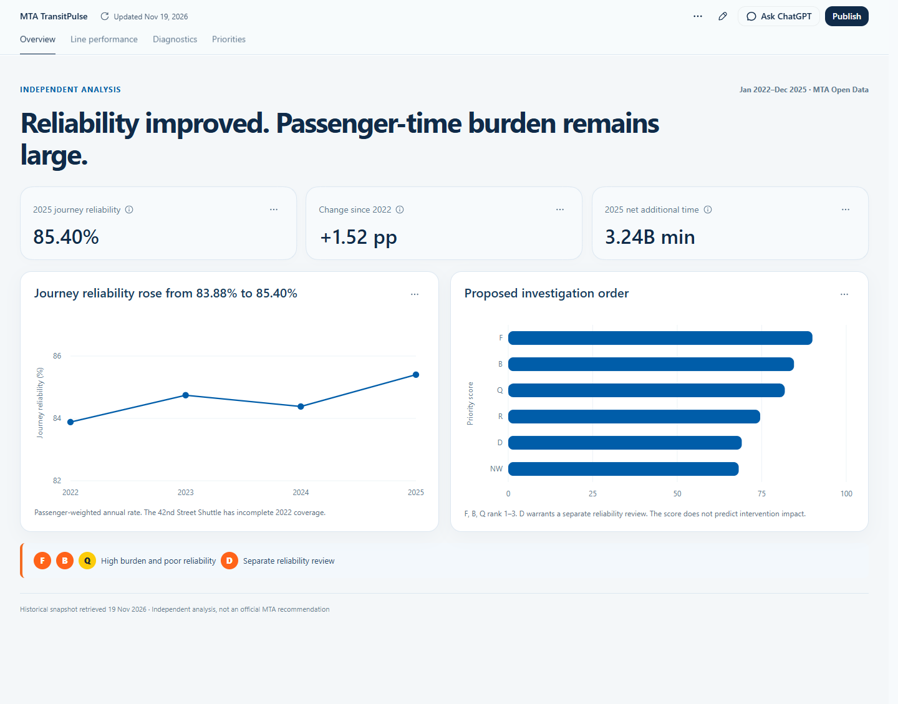
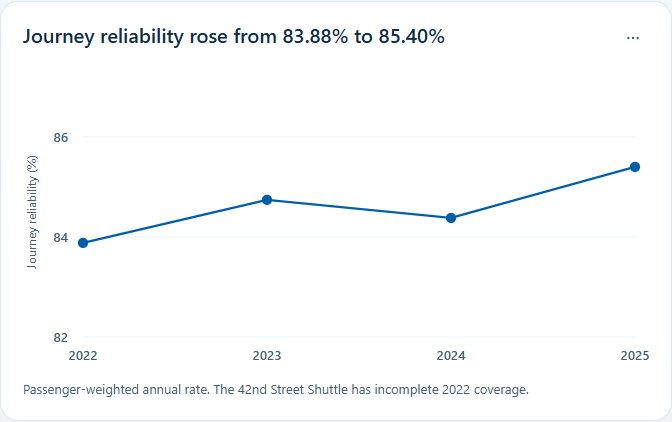
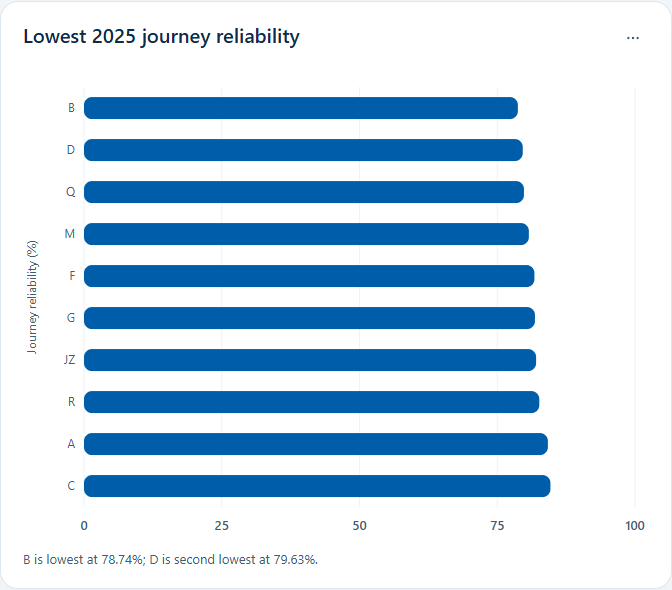
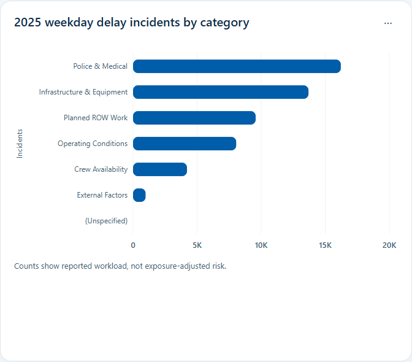
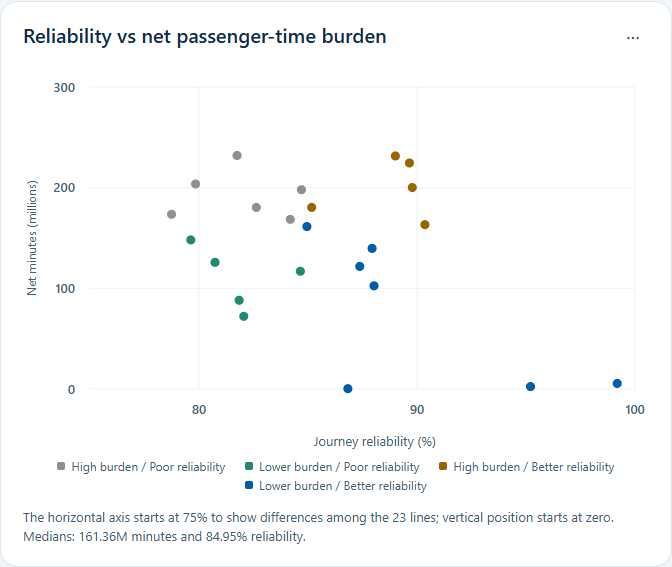

# MTA TransitPulse

[](https://github.com/DhruvShah-Dev/mta-transitpulse/actions/workflows/pages.yml)

**A reproducible analysis of NYC subway reliability, passenger-time burden, and where to investigate next.** The evidence covers January 2022 through December 2025 using four MTA datasets downloaded from the [New York State Open Data portal](https://data.ny.gov/). The source snapshot was retrieved on 19 November 2026; this is a historical portfolio analysis, not a live operations feed or an official MTA recommendation.

**[Open the interactive dashboard](https://dhruvshah-dev.github.io/mta-transitpulse/)** · [Executive case study PDF](reports/EXECUTIVE_CASE_STUDY.pdf) · [Power BI project](dashboards/TransitPulse.pbip)

**Stack:** Python · PostgreSQL · React · Power BI · GitHub Pages

**Explore:** [Featured charts](#featured-charts) · [Findings](#the-decision-in-three-findings) · [Reproduction](#run-the-browser-dashboard) · [Sources](#project-files-and-sources)

[](https://dhruvshah-dev.github.io/mta-transitpulse/)

The browser dashboard has four views: [Overview](dashboards/screenshots/web/overview.png), [Line performance](dashboards/screenshots/web/line-performance.png), [Diagnostics](dashboards/screenshots/web/diagnostics.png), and [Priorities](dashboards/screenshots/web/priorities.png). [Light](dashboards/screenshots/web/overview-mobile.png) and [dark](dashboards/screenshots/web/overview-mobile-dark.png) mobile captures show the responsive opening view. The [dark-theme Overview](dashboards/screenshots/web/overview-dark.png), [Line performance](dashboards/screenshots/web/line-performance-dark.png), [Diagnostics](dashboards/screenshots/web/diagnostics-dark.png), and [Priorities](dashboards/screenshots/web/priorities-dark.png) captures document the alternate theme.

## The decision in three findings

| Finding | Evidence | Implication |
| --- | --- | --- |
| Weekday customer journey reliability improved | Passenger-weighted CJTP rose from **83.88% in 2022 to 85.40% in 2025**, up **1.52 percentage points**. Excluding the 42nd Street Shuttle, which lacks two 2022 months, gives a like-for-like **+1.43-point** gain. | Track comparable service populations when interpreting change. |
| Passenger-time burden remains substantial | 2025 data imply **3.24B net additional passenger minutes** for the measured weekday unlinked trips. | Use aggregate burden alongside per-trip reliability; it is a signed estimate, not all riders' lost time. |
| Investigations can be sequenced | Under proposed 40% reliability, 40% burden, and 20% peak service weights, **F, B, Q** rank 1–3. **D** has the second-lowest CJTP and warrants a separate reliability review. | Investigate the shortlisted lines before choosing an intervention; the weights are analytical choices. |

See the [executive PDF](reports/EXECUTIVE_CASE_STUDY.pdf), [full case study with sources](reports/EXECUTIVE_CASE_STUDY.md), and [recruiter-friendly narrative](portfolio/CASE_STUDY.md).

## Featured charts

These chart captures come from the same validated snapshot as the [interactive dashboard](https://dhruvshah-dev.github.io/mta-transitpulse/). Open the dashboard to inspect sources and change the selected line.

### Reliability improved across four years



Passenger-weighted weekday CJTP increased **1.52 percentage points**. The 42nd Street Shuttle has incomplete 2022 coverage; the like-for-like gain excluding it is **1.43 points**.

### B and D have the lowest 2025 journey reliability



Bars start at zero to preserve percentage scale. The first two rates are **78.74% for B** and **79.63% for D**; the close bar lengths should be read with those values.

### Delay incidents show reported workload



**Police & Medical: 16,215** incidents; **Infrastructure & Equipment: 13,692**. These are counts across weekday hours, not exposure-adjusted risk or evidence of a cause of poor reliability.

### Reliability and passenger-time burden are separate dimensions



The reliability axis begins at **75%** to show the observed spread; passenger-time burden starts at zero. The proposed score puts **F, B, Q** first for investigation, while **D** receives a separate reliability review. Exact values and line identities are in the [2025 scorecard](data/analysis/line_priority_2025.csv).

## How the analysis works

```text
Four MTA Open Data extracts + documentation
    → Python cleaning and 51 source/model checks
    → PostgreSQL fact tables and monthly comparison view
    → SQL/Python exploratory analysis and five priority-weight scenarios
    → nine validated reporting tables and 10 reporting checks
    → fixed browser dashboard snapshot and four interactive views
    → companion Power BI project and executive case study
```

The browser dashboard is built from the checked 2022–2025 analysis outputs and runs as a fixed public snapshot, with no database login. The [Power BI project](dashboards/TransitPulse.pbip) and its [four page screenshots](dashboards/screenshots/) remain available as companion artifacts. The PBIP's model definitions embed reporting snapshots; Power BI Desktop is required to open or refresh it.

The dashboard follows Cole Nussbaumer Knaflic's *[Storytelling with Data](https://www.storytellingwithdata.com/book/downloads)* approach: lead with the decision and takeaway, choose familiar comparisons, remove visual clutter, and use emphasis sparingly. The chart titles and short notes distinguish observed customer outcomes from proposed investigation priorities.

Chart review: line charts show the 2022–2025 time trend; sorted horizontal bars show ordered line and incident comparisons from zero; and the scatterplot shows how reliability and passenger-time burden vary together. Its reliability axis begins at 75% to make the observed 78.74%–99.18% range legible, with the nonzero start stated beside the chart. The shortlist and comparison table keep exact values and line identities available without relying on color or hover.

The customer metric covers weekday estimated unlinked train trips from 6 a.m. to 11 p.m. Incident counts cover all weekday hours, while Service Delivered covers selected peaks. A line-month association is diagnostic evidence, not a causal estimate. Missing incident records remain missing; the separate major-incident source is never added to delay incidents. [KPI definitions](reports/KPI_DEFINITIONS.md), [limitations](reports/ANALYTICAL_LIMITATIONS.md), and [priority method](reports/PRIORITIZATION_METHOD.md) explain the rules.

## Run the browser dashboard

The committed snapshot is ready to build without PostgreSQL or Power BI. Use Node.js 24 or later:

```powershell
cd dashboards/transitpulse-web
npm.cmd ci
npm.cmd run build
python -m http.server 4173 --bind 127.0.0.1 --directory dist
```

Open `http://127.0.0.1:4173/`. From the repository root, `python src/build_web_dashboard_data.py` regenerates the web snapshot and updates the app's reviewed data from the committed analysis files. Rebuild the app after that command. To regenerate the ten full-view screenshots and four featured chart captures, install Python Playwright (`python -m pip install playwright`), provide a local Chrome installation, and run `python src/capture_web_dashboard.py` while the local server is running. The screenshot script checks the headline KPIs, route selector, chart rendering, light/dark chart-text contrast, and mobile overflow.

GitHub Pages builds the same app through [the deployment workflow](.github/workflows/pages.yml). The published page is a historical snapshot and does not refresh when the MTA portal changes.

## Reproduce from a clone

Use Python 3.11 or later and install `requirements.txt`. To rebuild the SQL outputs, install PostgreSQL command-line tools (`initdb`, `pg_ctl`, and `psql`) and make them available on `PATH`. The committed raw data reproduce the historical snapshot; running `download_data.py` fetches a new snapshot and can change the results.

```powershell
python -m pip install -r requirements.txt
python src/profile_data.py
python src/clean_data.py
python src/validate_data.py
python src/local_postgres.py setup
python src/local_postgres.py start
python src/load_postgres.py
python src/run_analysis.py
python src/analyze_relationships.py
python src/validate_analysis.py
python src/build_priority_scorecard.py
python src/create_priority_notebook.py
python src/validate_priority.py
python src/build_powerbi_reporting.py
python src/validate_powerbi_reporting.py
python src/build_web_dashboard_data.py
python src/build_pbip_model.py
python src/build_pbip_report.py
python src/build_case_study_pdf.py
```

`local_postgres.py setup` creates a private, loopback-only database beside the repository. Its credentials are generated locally and are not required to inspect the browser dashboard or committed Power BI definitions. Regenerate both snapshots after refreshing their underlying analysis and reporting layers.

## Project files and sources

- [Project plan](PROJECT_PLAN.md) — scope, analytical decisions, work sequence, and deliverables.
- [Initial data profile](data/INITIAL_PROFILE.md) — what the downloaded files contain and the issues to resolve before modeling.
- [Source manifest](data/source_manifest.json) — exact API URLs, row counts, SHA-256 checksums, and retrieval time.
- [Phase 2 validation summary](data/validation/VALIDATION_SUMMARY.md) — checked facts, reconciliation result, and source exceptions.
- [Transformation rules](docs/transformation_rules.md) and [line mapping](docs/line_mapping.csv) — metric units and source-specific service IDs.
- [Phase 3 findings](reports/EDA_FINDINGS.md), [KPI definitions](reports/KPI_DEFINITIONS.md), and [analytical limitations](reports/ANALYTICAL_LIMITATIONS.md).
- [Phase 4 priority method](reports/PRIORITIZATION_METHOD.md), [recommendations](reports/PRIORITY_RECOMMENDATIONS.md), and [2025 line scorecard](data/analysis/line_priority_2025.csv).

The four CSVs are in `data/raw/`. The MTA Overview and Data Dictionary PDFs are in `data/documentation/`; portal metadata snapshots are in `data/metadata/`. Run `python download_data.py` from this folder to refresh all source files. The script replaces the prior snapshot, so preserve a dated copy first if you need to compare revisions.

| Dataset | ID | Local file |
| --- | --- | --- |
| [Customer Journey-Focused Metrics](https://data.ny.gov/d/r7qk-6tcy) | `r7qk-6tcy` | `data/raw/subway_customer_journey.csv` |
| [Delay-Causing Incidents](https://data.ny.gov/d/g937-7k7c) | `g937-7k7c` | `data/raw/subway_delay_incidents.csv` |
| [Major Incidents](https://data.ny.gov/d/ereg-mcvp) | `ereg-mcvp` | `data/raw/subway_major_incidents.csv` |
| [Service Delivered](https://data.ny.gov/d/32ch-sei3) | `32ch-sei3` | `data/raw/subway_service_delivered.csv` |

## Project layout

`data/processed/` holds validated analytical tables. `src/` holds repeatable Python transformations and checks. `sql/` holds the database schema, marts, and analytical queries. `reports/` holds findings and decision methods. `dashboards/transitpulse-web/` holds the browser dashboard; `dashboards/` also holds the Power BI project and screenshots.

## Phase 2 commands

From this folder, run `python src/profile_data.py`, `python src/clean_data.py`, and `python src/validate_data.py`. The four fact tables and monthly view were loaded into a dedicated local PostgreSQL instance for this analysis. For a fresh clone, run `python src/local_postgres.py setup` once, then `python src/local_postgres.py start`. The database uses the `mta` schema in its `postgres` database. Its generated password and cluster live in a sibling `.mta-local-postgres` folder outside this repository; do not commit or share that folder. `status` and `connect` are available through the same script.

Run `python src/load_postgres.py` to refresh the local database. The loader validates the local files first, replaces the `mta` schema's fact contents transactionally, creates the monthly view, and runs SQL reconciliation checks. To target another PostgreSQL server, set `MTA_DATABASE_URL` or standard `PG*` connection variables. The SQL files can also be inspected or run with `psql`; `sql/02_load_data.sql` expects the working directory to be this project root.

## Phase 3 analysis

Run `python src/run_analysis.py`, `python src/analyze_relationships.py`, and `python src/validate_analysis.py` in that order. The first script executes the queries in `sql/analysis/` and writes their CSV results to `data/analysis/`, including the combined annual customer scorecard and 2025 comparison-group scorecard. The second script computes descriptive monthly associations. The last script checks source reconciliation, coverage, priority-screen logic, and the executed notebook outputs. The notebooks are `notebooks/01_exploratory_analysis.ipynb` and `notebooks/02_relationship_analysis.ipynb`.

## Phase 4 prioritization

Run `python src/build_priority_scorecard.py`, `python src/create_priority_notebook.py`, and `python src/validate_priority.py` in that order. The scorecard script executes `sql/analysis/07_priority_components.sql` against the local PostgreSQL model, writes `data/analysis/line_priority_2025.csv` and `priority_metadata.json`, and evaluates five weight scenarios. The executed `notebooks/03_priority_analysis.ipynb` contains the priority matrix, line history, and sensitivity charts. The final validation result is `data/analysis/priority_validation.json`.

## Phase 5A Power BI reporting layer

Run `python src/build_powerbi_reporting.py` and `python src/validate_powerbi_reporting.py`. The first script creates `mta.rpt_*` PostgreSQL reporting objects, loads the fixed 2025 priority scorecard, and writes nine import-ready CSV mirrors under `data/powerbi/`. The second checks source reconciliation, keys, coverage, signed values, and the reported 2025 KPIs.

## Phase 5B Power BI dashboard

Open [TransitPulse.pbip](dashboards/TransitPulse.pbip) in Power BI Desktop. It contains a nine-table Import model, 31 DAX measures, 11 relationships, and four report pages. The model definitions embed compressed copies of the validated `data/powerbi/` reporting snapshots rather than machine-specific CSV paths. Power BI Desktop is required to verify a fresh-clone model refresh. Screenshots of the authored pages are in [dashboards/screenshots](dashboards/screenshots/).

To rebuild the authored project definitions after changing reporting exports or measures, run `python src/build_pbip_model.py` and `python src/build_pbip_report.py`, then apply external changes or reopen the PBIP in Desktop and refresh. The [model specification](dashboards/TransitPulseModel/MODEL_SPEC.md), [DAX measure source](dashboards/TransitPulseModel/MEASURES.dax), and [report plan](dashboards/TransitPulseModel/REPORT_PLAN.md) document the design and KPI rules. The 2025 scorecard uses proposed decision weights, not official MTA policy.
