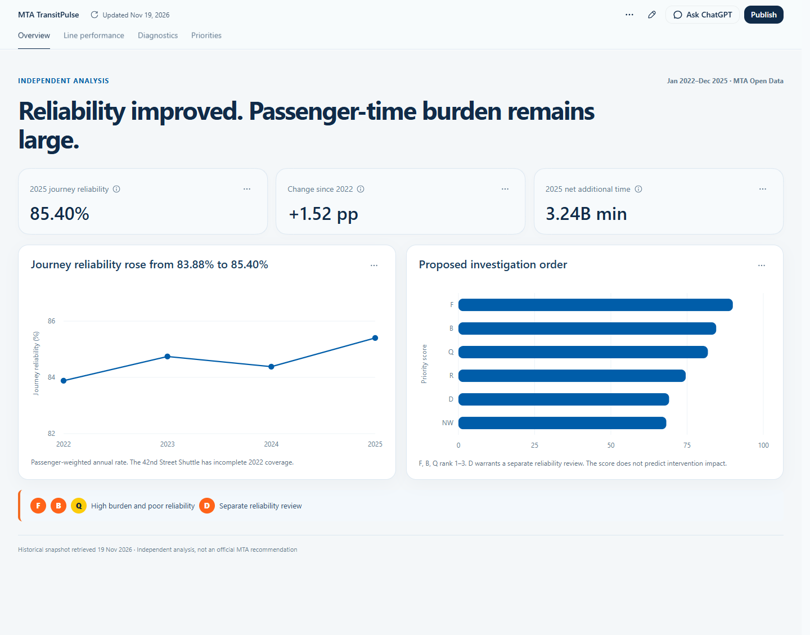
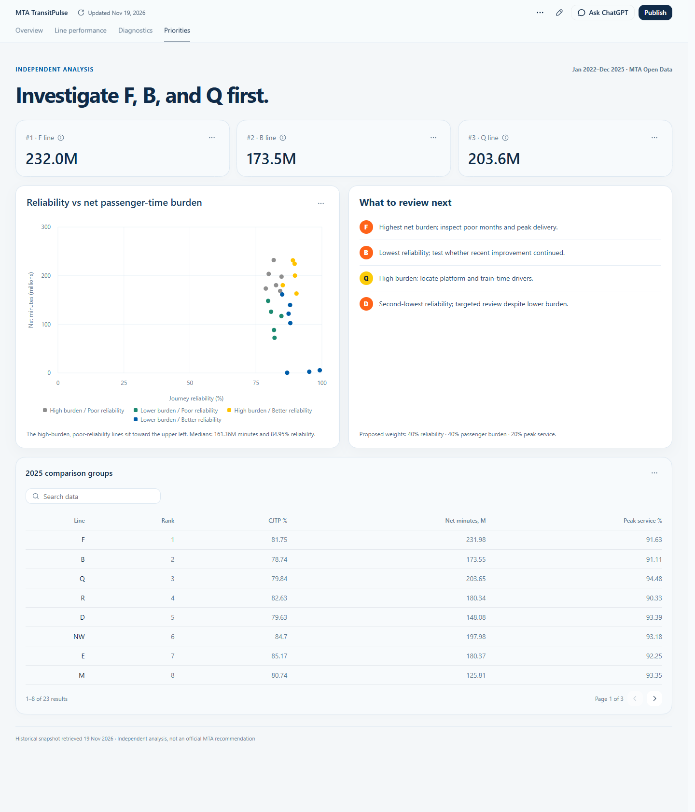

# MTA TransitPulse: turning subway reliability data into an investigation plan

**Portfolio case study · NYC subway · January 2022–December 2025**

## The question

Which subway lines combine weak customer reliability with a large passenger-time burden, and what should an operations team investigate first?

Systemwide performance alone cannot answer that question. A line can improve on average while still creating substantial additional time for many riders. I built TransitPulse to connect customer-experienced performance, estimated time burden, incident patterns, and peak service delivery in one reproducible analysis.

## What I built

I downloaded four MTA Open Data datasets, documented the source snapshot, cleaned and reconciled 21,475 records, and modeled the facts in PostgreSQL. SQL and Python produced weighted KPIs, line-level trends, diagnostic associations, and a 2025 priority scorecard. I tested five weight scenarios and built a [four-view browser dashboard](https://dhruvshah-dev.github.io/mta-transitpulse/) from the validated snapshot. The Power BI project remains in the repository as a companion model.

**Tools:** Python, pandas, PostgreSQL, SQL, Jupyter, React, Power BI, DAX, Power Query.

## What the evidence showed

- **Reliability improved:** weekday passenger-weighted Customer Journey Time Performance rose from 83.88% in 2022 to 85.40% in 2025, a 1.52-point increase. Excluding the 42nd Street Shuttle's incomplete 2022 observations gives a comparable 1.43-point increase.
- **Passenger-time burden persisted:** the 2025 customer estimate totals 3.24 billion signed net additional passenger minutes across its measured weekday unlinked trips. Average additional journey time per trip improved, while the aggregate total grew with estimated trip volume.
- **F, B, and Q were robust investigation priorities:** they ranked 1, 2, and 3 under the proposed 2025 weighting, and each stayed in the top four across five scenarios. D had the second-lowest customer journey-time performance and received a separate reliability review.

## The decision I would support

Start a line-specific diagnostic review of F, B, and Q, then investigate D's weak reliability separately. Use station, period, service-plan, and event-level records to identify where problems occur before changing schedules or allocating a budget. Incident correlations in this project are descriptive and do not identify an intervention's effect.

## Why the analysis is defensible

The pipeline checks source hashes, key uniqueness, row counts, missing observations, and weighted metric identities. Cleaning and modeling passed 51 automated checks; the Power BI reporting layer passed 10 more. The dashboard reproduces 85.40% CJTP and 3.24B net minutes for 2025. The published score is explicitly a proposed screening method, not an official MTA ranking.

The customer metric excludes weekends, late nights, and transfers; net minutes are signed model estimates. Incident counts do not measure line risk without a service-exposure denominator. These limits are kept beside the recommendations in the [executive case study](../reports/EXECUTIVE_CASE_STUDY.pdf), with the full [method and reproducibility guide](../README.md) in the repository.
